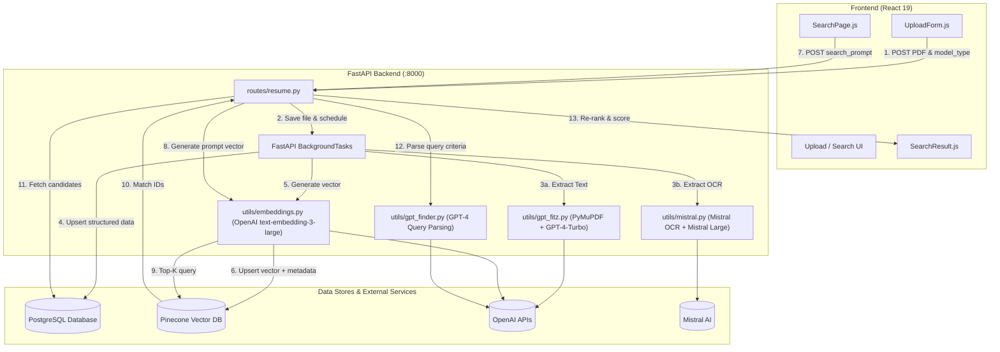

# ResumeParserAI — Comprehensive Architecture & Code Documentation

A complete, in-depth architectural and code-level reference for the **ResumeParserAI** project.

---

## 1. System Overview & Architecture

**ResumeParserAI** is a full-stack, AI-driven resume parsing and semantic retrieval platform. It automates candidate profile extraction from raw PDF resumes and provides a natural language search interface for recruiters.

### High-Level Architecture Diagram



---

## 2. Technology Stack & Key Technical Aspects

| Category | Technology | Purpose |
| :--- | :--- | :--- |
| **Backend Framework** | **FastAPI** (Python 3.9+) | Asynchronous REST API, CORS middleware, background task queueing, dependency injection. |
| **Relational Database** | **PostgreSQL** + **SQLAlchemy** | Stores relational metadata and JSON columns for multi-attribute resume structures. |
| **Vector Database** | **Pinecone** | High-dimensional vector index for fast semantic similarity search. |
| **LLMs & Embeddings** | **OpenAI** (`gpt-4-turbo`, `gpt-4`, `text-embedding-3-large`) | Structured entity extraction, natural language query decomposition, and 3072-dim embeddings. |
| **OCR & Vision** | **Mistral AI** (`mistral-ocr-latest`, `mistral-large-latest`) | Document upload, signed URL processing, OCR markdown generation, and structuring. |
| **PDF Extraction** | **PyMuPDF (`fitz`)** | Fast text extraction from clean digital PDFs without OCR latency. |
| **Frontend Framework** | **React 19** + **React Router v7** | Single-page application for uploading and searching resumes. |
| **HTTP Client** | **Axios** & **Fetch API** | Handles multipart file uploads and JSON API communication. |

---

## 3. End-to-End Data & Processing Flows

### 3.1 Resume Upload & Ingestion Flow
1. **File Selection**: User selects a PDF resume and chooses a parsing model (`GPT+Fitz` or `Mistral`) on `UploadForm.js`.
2. **Multipart Submission**: Form data is posted to `/api/v1/resume/`.
3. **Local File Persistence**: The FastAPI route saves the file to disk in `backend/uploads/`.
4. **Asynchronous Background Task**: FastAPI queues `_process_resume_extraction` in the background and immediately responds with HTTP 200/202 to keep the UI non-blocking.
5. **Text & Entity Extraction**:
   - **`gpt_fitz`**: PyMuPDF extracts selectable text $\rightarrow$ sent to `gpt-4-turbo` $\rightarrow$ parsed into structured JSON.
   - **`mistral`**: File uploaded to Mistral $\rightarrow$ OCR engine processes pages into markdown $\rightarrow$ `mistral-large-latest` converts markdown into structured JSON.
6. **Relational Upsert**: `store_resume_data` checks PostgreSQL for the candidate's email. If found, it updates the record; otherwise, it inserts a new row.
7. **Vector Embedding & Storage**:
   - Structured JSON is compiled into a text summary via `_prepare_generation_text`.
   - `text-embedding-3-large` generates a 3072-dimensional vector.
   - The vector is upserted into Pinecone with the PostgreSQL `id` in the metadata.
   - If Pinecone fails, the database row is rolled back to prevent orphaned records.

### 3.2 Candidate Search & Hybrid Retrieval Flow
1. **Search Prompt Input**: The recruiter inputs a natural language prompt (e.g., *"5+ years Python developer with FastAPI and AWS experience"*).
2. **Dense Vector Search**:
   - OpenAI generates an embedding for the prompt.
   - Pinecone finds the top $K$ candidate vector matches using cosine similarity.
3. **Candidate Record Retrieval**: The system fetches full candidate records from PostgreSQL using the matching IDs.
4. **Query Decomposition**:
   - `extract_prompt_info` invokes `gpt-4` to break the query into target criteria (skills list, job roles, education, certifications, projects, minimum GPA).
5. **Attribute Re-ranking & Scoring**:
   - For each candidate, set intersections are computed between the candidate's structured attributes and the target criteria.
   - An overall `match_score` is computed.
6. **Result Display**: The highest-scoring candidate is returned to the frontend and rendered in `SearchResult.js`.

---

## 4. File-by-File & Function-by-Function Breakdown

### 4.1 Backend Components

#### `backend/database.py`
Manages PostgreSQL connections, engines, sessions, and table initialization.
* `ADMIN_URL` & `DATABASE_URL`: Connection strings for the PostgreSQL admin database and application database.
* `ensure_database_exists(db_name: str) -> bool`: Checks if the target database exists; creates it dynamically if absent.
* `create_tables() -> bool`: Creates all SQLAlchemy models (`Resume`) in the database.
* `get_db()`: Generator dependency providing database sessions for FastAPI routes, ensuring clean teardown.
* `get_db_config() -> dict`: Exposes database connection credentials from environment variables.

#### `backend/models.py`
Defines the relational ORM schema for resumes.
* `Resume(Base)`:
  - `id`: Integer primary key (indexed).
  - `name`, `email` (unique, indexed), `phone_number`: Candidate contact info.
  - `skills`: JSON dictionary of skill categories and keywords.
  - `work_experience`: JSON list of work experiences (roles, companies, durations, descriptions).
  - `education`: JSON list of degrees, institutions, and years.
  - `certifications`: JSON list of certifications.
  - `projects`: JSON list of projects.
  - `gpa`: String representation of GPA.
  - `model_type`: Parsing engine used (`gpt_fitz` or `mistral`).

#### `backend/schemas.py`
Defines Pydantic models for validation and serialization.
* `ResumeBase`: Common attributes across all resume schemas.
* `ResumeCreate`: Schema for incoming resume objects.
* `ResumeResponse`: Output schema including database `id` with `orm_mode = True`.
* `SearchRequest`: Input schema containing `user_prompt: str`.

#### `backend/main.py`
FastAPI server setup, middlewares, and lifecycle handlers.
* `Settings(BaseSettings)`: Validates environment variables from `.env`.
* Middlewares:
  - `CORSMiddleware`: Permits requests from `http://localhost:3000`.
  - `TrustedHostMiddleware`: Restricts hosts when running with `DEBUG=False`.
  - `add_process_time_header`: Records request execution duration in `X-Process-Time`.
* Exception Handlers:
  - `database_exception_handler`: Handles `SQLAlchemyError` with HTTP 503.
  - `global_exception_handler`: Handles unexpected exceptions with HTTP 500.
* Lifecycle Events:
  - `startup_event()`: Initializes database and tables.
  - `shutdown_event()`: Cleans up resources.
* Endpoints:
  - `root()` (`GET /`): Basic status and version endpoint.
  - `health_check(db)` (`GET /health`): Probes database connectivity via `SELECT 1`.

#### `backend/routes/resume.py`
Implements core API endpoints and ingestion workflows.
* `get_travel_resume(resume_id, db)` (`GET /api/v1/resume/{resume_id}`): Fetches a single resume by its ID.
* `store_resume_data(extracted_data, db) -> int`: Upserts extracted resume details into PostgreSQL.
* `extract_resume_data(pdf_path, model_type)`: Dispatches extraction to `gpt_fitz` or `mistral`.
* `_delete_resume_from_db(resume_id, db)`: Rollback helper to delete a resume if vector indexing fails.
* `_store_resume_embedding(resume_description, resume_id, db) -> bool`: Orchestrates Pinecone embedding generation and rollback on failure.
* `_prepare_generation_text(data) -> str`: Flattens structured JSON into a clean string for vector embedding.
* `_process_resume_extraction(file_path, db, model_type)`: Async worker function for parsing, storing, and indexing resumes.
* `upload_resume(model_type, file, background_tasks, db)` (`POST /api/v1/resume/`): Receives PDF, saves locally, and spawns background extraction.
* `get_travel_resume_by_id(db, resume_id)`: Queries database for candidate by ID.
* `process_resume_search_rag(request, db)` (`POST /api/v1/search-resume/`): Executes vector search + LLM query parsing + multi-attribute scoring.

#### `backend/utils/embeddings.py`
Vector embeddings and Pinecone integration.
* `init_pinecone()`: Connects to the Pinecone client and verifies the target index.
* `generate_embeddings(text: str) -> List[float]`: Uses OpenAI `text-embedding-3-large` to generate 3072-dimensional embeddings.
* `store_embedding(text: str, id: int) -> int`: Upserts embedding vector and metadata into Pinecone.
* `match_embeddings(user_embedding, top_k=3) -> List[str]`: Queries Pinecone for top matches using cosine similarity.

#### `backend/utils/gpt_fitz.py`
* `extract_resume_data_and_structure(pdf_path: str) -> dict`: Extracts text from digital PDFs via PyMuPDF (`fitz`) and formats it into JSON using `gpt-4-turbo`.

#### `backend/utils/mistral.py`
* `extract_and_structure_resume(pdf_path: str) -> dict`: Uploads PDF to Mistral AI, runs OCR via `mistral-ocr-latest`, and structures the output using `mistral-large-latest`.

#### `backend/utils/gpt_finder.py`
* `extract_prompt_info(description: str) -> Dict[str, Any]`: Prompts `gpt-4` to parse user search queries into distinct search criteria (skills, job roles, education, certifications, projects, GPA).

---

### 4.2 Frontend Components

#### `frontend/src/App.js`
Main component and router configuration using React Router v7. Renders global navigation and defines routes:
- `/upload` $\rightarrow$ `UploadForm`
- `/search` $\rightarrow$ `SearchPage`
- `/search-result` $\rightarrow$ `SearchResult`
- `/thank-you` $\rightarrow$ `ThankYouPage`

#### `frontend/src/UploadForm.js`
Resume upload interface.
- Manages file state and extraction model selection (`GPT+Fitz` or `Mistral`).
- Sends `multipart/form-data` requests to the backend using Axios.
- Navigates to `/thank-you` upon submission.

#### `frontend/src/SearchPage.js`
Recruiter search interface.
- Accepts natural language criteria queries.
- Sends POST request to `/api/v1/search-resume/`.
- Redirects to `/search-result` with the matched candidate data.

#### `frontend/src/SearchResult.js`
Displays matching candidate details including contact information, categorized skills, work experience history, education, certifications, projects, and GPA.

#### `frontend/src/ThankYouPage.js`
Confirmation view displayed after a resume upload is submitted.

---

## 5. How to Run the Project (Step-by-Step)

### 5.1 Prerequisites
- **Python 3.9+** (Tested on Python 3.12)
- **Node.js (v18+) & npm**
- **PostgreSQL Server** (local or Docker container)
- API Keys:
  - **OpenAI API Key** (for embeddings and GPT parsing)
  - **Mistral API Key** (for Mistral OCR and structuring)
  - **Pinecone API Key & Environment** (with index dimension 3072 and metric `cosine`)

---

### 5.2 Backend Setup

1. **Navigate to the backend directory**:
   ```bash
   cd backend
   ```

2. **Create and activate a virtual environment**:
   ```bash
   # Windows PowerShell
   python -m venv venv
   .\venv\Scripts\activate

   # Linux / macOS
   python3 -m venv venv
   source venv/bin/activate
   ```

3. **Install dependencies**:
   ```bash
   pip install fastapi uvicorn pydantic pydantic-settings sqlalchemy psycopg2-binary python-dotenv pymupdf openai pinecone mistralai python-multipart
   ```

4. **Configure environment variables**:
   Create a `.env` file in `backend/` with:
   ```ini
   # PostgreSQL Configuration
   POSTGRES_USER=postgres
   POSTGRES_PASSWORD=your_password
   POSTGRES_HOST=localhost
   POSTGRES_PORT=5432
   POSTGRES_DB=resume_parser_db

   # OpenAI API Key
   OPENAI_API_KEY=sk-...

   # Mistral API Key
   MISTRAL_API_KEY=...

   # Pinecone Vector DB
   PINECONE_KEY=...
   PINECONE_ENVIRONMENT=...
   INDEX_NAME=resume-embeddings

   # Application Mode
   DEBUG=True
   ```

5. **Start the backend server**:
   ```bash
   uvicorn main:app --reload --host 0.0.0.0 --port 8000
   ```
   - API Root: `http://localhost:8000`
   - Interactive Swagger Docs: `http://localhost:8000/docs`
   - Health Check: `http://localhost:8000/health`

---

### 5.3 Frontend Setup

1. **Navigate to the frontend directory**:
   ```bash
   cd frontend
   ```

2. **Install dependencies**:
   ```bash
   npm install
   ```

3. **Start the React development server**:
   ```bash
   npm start
   ```
   - UI will open at `http://localhost:3000`.

---

## 6. Architectural Insights & Best Practices

1. **Non-Blocking Ingestion**: Using FastAPI `BackgroundTasks` ensures PDF parsing and OCR latency (1.5s–5s) does not block user interaction.
2. **Hybrid Search Accuracy**: Combining Pinecone vector retrieval with GPT-4 attribute decomposition provides semantic recall alongside keyword precision.
3. **Resilient Data Consistency**: If vector embedding or Pinecone upsert fails, the system rolls back the database entry via `_delete_resume_from_db` to prevent orphaned records.
4. **OCR vs Digital PDF Parsing**:
   - `PyMuPDF + GPT-4-Turbo` provides high accuracy on clean digital PDFs.
   - `Mistral OCR` handles complex multi-column layouts and scanned image PDFs.

